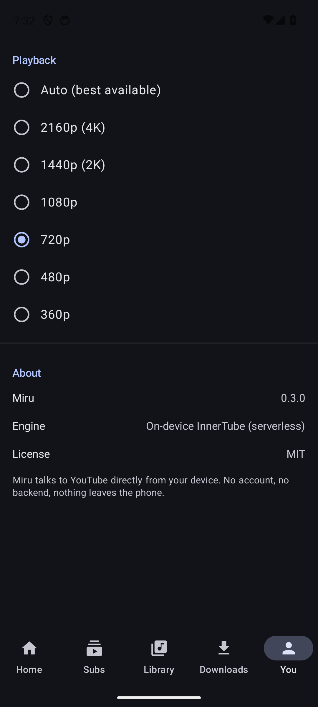
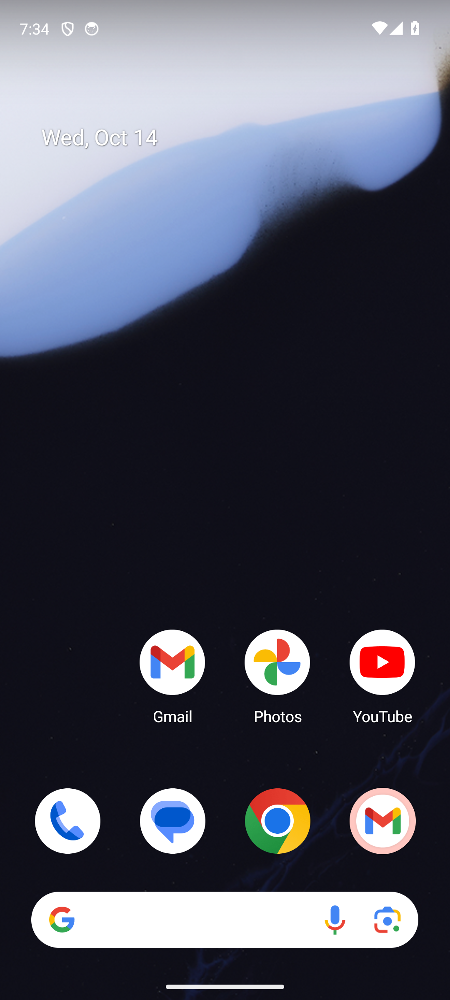

# miru (見る)

A clean, ad-free YouTube client for Android that extracts everything **on-device** — no backend, no account, no tracking.

<p align="center">
  
  
  
  
</p>

## Why

Most open-source YouTube clients are powerful but dense and dated. `miru` aims
for a clean, LibreTube-grade Material 3 experience — but unlike most of them it
runs **entirely on the phone**. There is no server to deploy, no IP to get
blocked, and no subscription data leaving your device.

## Highlights

- **Serverless extraction** — talks to YouTube's InnerTube API directly from Kotlin.
- **Ad-free playback** at up to 2160p, with reliable audio track selection.
- **Background + picture-in-picture** via a `MediaSession`-backed playback service.
- **SponsorBlock** auto-skip and **Return YouTube Dislike** estimates.
- **Downloads, subscriptions, and watch history** stored locally (Room).
- **No login.** There is no account system to hold your data.

## Screenshots

<p align="center">
  
  
</p>

## Feature status

| Feature | Status |
|---|---|
| Clean Compose Material 3 UI | done |
| Ad-free playback (InnerTube) | done |
| Search | done |
| Downloads | done (single-file; track muxing is v2) |
| SponsorBlock | done |
| Return YouTube Dislike | done |
| Background / PiP audio | done |
| Subscriptions + history | done (local only) |
| Playback quality preference | done |
| Age-restricted (18+) content | v2 (deferred) |

Bottom navigation: Home · Subs · Library · Downloads · You

## Architecture

```
Android app (Compose M3, Media3, Room, WorkManager, Coil)
        |
        |-- InnerTube (Kotlin, on-device)  --> YouTube catalog + player
        |-- SponsorBlock API               --> skip segments
        |-- Return YouTube Dislike API     --> like/dislike estimates
        |-- googlevideo CDN                --> media bytes (bounded ranges)
```

The extractor uses two InnerTube client profiles: an **ANDROID_VR** client for
catalog (search, browse, channel) and an **iOS** client for the player, which
returns plain, un-ciphered stream URLs up to 2160p and avoids needing a
JavaScript runtime for signature deciphering.

Media is streamed through a custom `DataSource` that requests bounded byte
ranges and stitches them into one continuous stream. googlevideo rejects
oversized or open-ended range requests, and its `rqh=1` URLs stop serving a
rendition after a while, so each window is kept modest and — when a read is
refused past the first window — a fresh URL for the *same* rendition is minted
and playback continues from the same offset. The stream therefore survives a
URL expiring mid-video instead of stopping.

Re-minting is budgeted: only a genuinely new load gets a fresh budget, so a
retry of the *same* load cannot spin against a throttled endpoint. That keeps a
rate-limited server from being hammered (and the throttle from worsening) while
normal long-form playback still refreshes as needed.

## Building

Requires the Android SDK (compileSdk 35) and JDK 17.

```sh
cd android
./gradlew assembleDebug
# APK at android/app/build/outputs/apk/debug/app-debug.apk
```

## Legal

`miru` is an unofficial client and is not affiliated with YouTube. It is
provided for personal, educational use. Streaming and downloading content may
violate YouTube's Terms of Service; you are responsible for how you use it.
